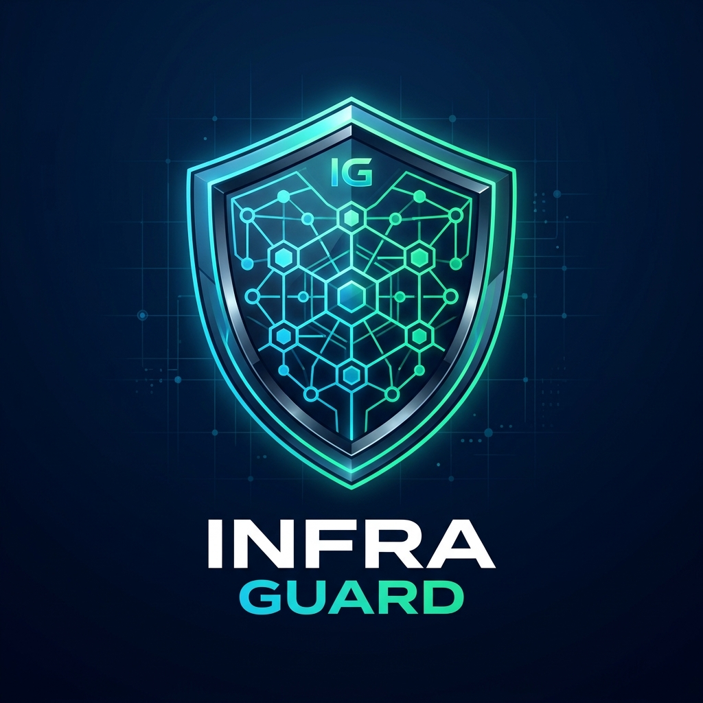
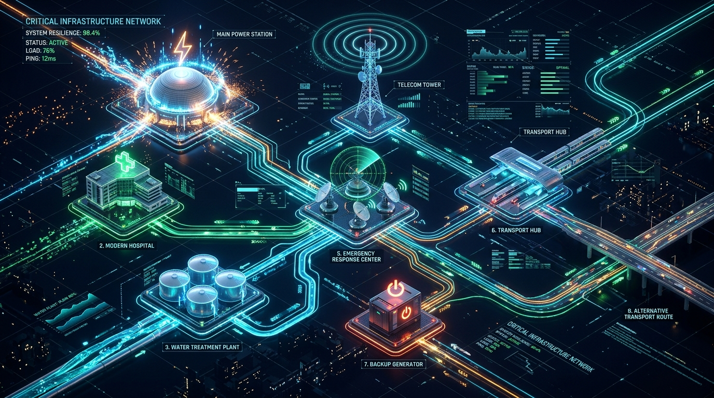

# 🛡️ InfraGuard AI

<p align="center">
  
</p>

> **When One Failure Becomes Many — Simulate, Analyze, Recover.**

InfraGuard AI is an infrastructure-resilience multi-agent system built on Fetch.ai's `uagents` and the **Agent Chat Protocol**. It simulates infrastructure failure cascades across power, water, telecom, healthcare, and transport sectors, identifies downstream bottlenecks, verifies alternative routes, and recommends deterministic recovery actions.

<p align="center">
  
</p>

## ✨ Key Feature: Resilience Twin

Compare a **baseline failure scenario** with an **alternative recovery scenario** and see the verified difference in operational services, affected infrastructure, and route availability.

## 🏗️ Architecture

```
Python InfraGuard Application
    ├── NetworkX infrastructure simulation engine
    ├── Deterministic impact and route analysis
    ├── InfraGuard uAgent (Fetch.ai)
    │       ├── Agent Chat Protocol (ACP v0.3.0)
    │       ├── Agentverse mailbox connection
    │       └── ASI:One discovery
    └── Streamlit Dashboard (visual demo)
```

## 🚀 Quick Start

### Prerequisites
- Python 3.12+
- Git

### Installation

```bash
# Clone the project
cd my_agents_project

# Create virtual environment (if not already done)
python -m venv venv

# Activate (Windows)
.\venv\Scripts\activate

# Install dependencies
pip install -r requirements.txt
```

### Configure

```bash
# Copy the environment template
copy .env.example .env

# Edit .env and set your own unique INFRAGUARD_SEED
```

### Run the Dashboard

```bash
.\venv\Scripts\streamlit.exe run app.py
```

Opens at http://localhost:8501

### Run the uAgent

```bash
.\venv\Scripts\python.exe main.py
```

The agent will print its address and Inspector URL.

### Run Tests

```bash
.\venv\Scripts\python.exe -m pytest tests/ -v
```

## 📡 Agent Commands

The InfraGuard agent understands natural-language queries:

| Command | Example |
|---------|---------|
| Simulate failure | "What happens if the Main Power Station fails?" |
| Activate backup | "Activate Backup Generator" |
| Check route | "Check route from Transport Hub to Emergency Response Center" |
| Critical services | "Which critical services are affected?" |
| Recover | "Recover Main Power Station" |
| Status | "Status" |
| Reset | "Reset" |
| Help | "Help" |

## 🌐 Infrastructure Model

8 infrastructure components connected by a directed dependency graph:

| Component | Type | Critical |
|-----------|------|----------|
| Main Power Station | Power | ✅ |
| Backup Generator | Backup Power | ❌ |
| Hospital | Medical | ✅ |
| Water Treatment Plant | Water | ✅ |
| Telecom Tower | Telecom | ✅ |
| Transport Hub | Transport | ❌ |
| Emergency Response Center | Emergency | ✅ |
| Alternative Transport Route | Transport | ❌ |

### Edge Types
- **Power supply** — Main Power Station → dependents
- **Backup power** — Backup Generator → Hospital, Emergency Response Center (requires explicit activation)
- **Water supply** — Water Treatment Plant → Hospital
- **Communications** — Telecom Tower → Emergency Response Center
- **Transport** — Transport Hub ↔ Emergency Response Center, Alternative Transport Route

### Severity Formula

```
severity_score = (affected_critical_count / total_critical_count) × 100

0%     → NORMAL
1-39%  → LOW
40-59% → MODERATE
60-79% → HIGH
80-100% → CRITICAL
```

## 🔬 Resilience Twin Workflow

1. **Fail** a component (e.g., Main Power Station)
2. **Capture** the baseline snapshot
3. **Activate** a backup or recover a component
4. **Capture** the recovery snapshot
5. **Compare** — see services recovered, improvement score, before/after networks

## 📁 Project Structure

```
my_agents_project/
    app.py                    # Streamlit dashboard
    main.py                   # InfraGuard uAgent
    requirements.txt          # Pinned dependencies
    .env.example              # Environment template
    .gitignore
    infraguard/
        __init__.py
        infrastructure.py     # Graph definition
        simulation.py         # Core simulation engine
        routing.py            # Route analysis
        recovery.py           # Recovery utilities
        commands.py           # NL command parser
    tests/
        test_simulation.py    # 56 unit tests
        test_routing.py
        test_recovery.py
```

## ⚠️ Known Limitations

- **Educational simulation** — synthetic assumptions, not validated engineering.
- Severity scores reflect modeled impact, not certified risk assessments.
- Backup activation is instant in the model; real systems have complex procedures.
- Route availability uses graph connectivity, not physical transport logistics.
- Recovery is instantaneous; no modeled repair times.
- Single-agent architecture; no distributed recovery agent.

## 🛠️ Tech Stack

- **Python 3.12** — core runtime
- **NetworkX 3.7** — directed dependency graph
- **Fetch.ai uAgents 0.26.1** — agent framework
- **Agent Chat Protocol v0.3.0** — Agentverse/ASI:One compatibility
- **Streamlit 1.66.1** — interactive dashboard
- **Plotly 7.1.0** — network visualization and gauges

## 📜 License

Educational project — hackathon submission.

---

*Built for demonstrating infrastructure resilience analysis with AI agents.*
